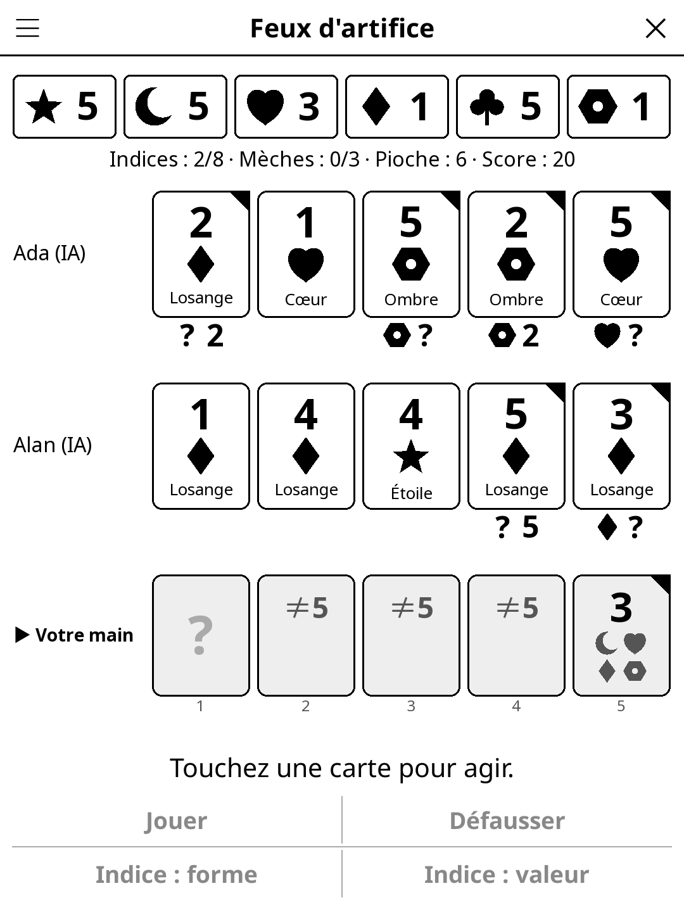

# Fireworks — KOReader Plugin

> Cooperative hidden-hand card game (Feux d'artifice): build five fireworks
> together while seeing every hand but your own. Pass the reader around for
> 2-5 players, or play solo with computer teammates.

## Screenshot



## Rules

All players win or lose together. The deck has five suits — **Star, Moon,
Heart, Diamond, Clover**, each drawn with its own shape and named on the card,
so no colour is needed on e-ink — and in each suit three 1s, two 2s, two 3s,
two 4s and one 5. The table builds one firework per suit, from 1 to 5 in order.

You hold your cards facing away from you: you see everyone else's hand, never
your own. On your turn, do one of:

- **Give a clue** (costs one of the 8 clue tokens): pick a teammate and a shape
  or a rank. The clue points out *all* of their cards of that shape or rank —
  at least one. They learn which cards match, and which don't.
- **Discard** a card (regains a clue token; not allowed with 8 tokens).
- **Play** a card: if it continues its firework it is added, otherwise it is
  discarded and a fuse burns.

After a play or a discard you draw. Completing a firework with its 5 gives a
clue token back. The game ends at the 3rd fuse, when every firework is
complete (25), or when the deck is empty and everyone has had one last turn.
The score is the sum of the fireworks:
0-5 horrible · 6-10 mediocre · 11-15 honourable · 16-20 excellent ·
21-24 amazing · 25 legendary.

Hands: 5 cards with 2-3 players, 4 cards with 4-5 players.

### Variants and options

Each variant adds a 6th suit (30 points at most):

- **Rainbow (wild)**: ten cards (3/2/2/2/1) that count as every suit — any
  shape clue touches them, and they can't be named in a clue.
- **Rainbow (own colour)**: ten cards, a suit like the others with its own clue.
- **Black (single cards)**: one card of each rank only: every one is critical.

Menu → Settings: **Short game** (the game ends as soon as the last card is
drawn), **Third fuse: score 0** (as in some editions), and **Suit names**:
Fireworks (Star, Moon…), Planets (Sun, Moon, Venus, Mars, Earth, Saturn,
Black hole) or Gems (Sapphire, Pearl, Ruby, Topaz, Emerald, Opal, Onyx) — the
shapes stay the same.

The end screen picks one of more than ten verdicts per score band, in English
or French ("Louis XIV demands a copy for Versailles.").

## Playing on one reader

- **Hand-over screen**: before each turn the reader says who should take it
  ("Pass the reader to Alice"), with a summary of everything that happened
  since that player's last turn ("Bob gave Alice a clue: two 5s (positions 1,
  4)"). Tap when ready.
- **Your turn**: the stacks and counters at the top, then each teammate's hand
  face up. Under a teammate's clued card a small line shows what *they* know
  about it. Your own hand, at the bottom and drawn larger, only shows your
  knowledge: the rank if known, "≠3" when only a 3 is ruled out, else the ranks
  still possible; the shape if known, "≠" and a shape when only that one is
  ruled out, else the shapes still possible; a black corner on clued cards.
  Position 1 is your newest card.
- **Act**: tap one of your cards, then **Play** or **Discard**; or tap a
  teammate's card, then **Clue: shape** or **Clue: rank** — the matching cards
  are highlighted, then **Give this clue** (or Cancel).

## Solo mode and tutorial

Menu → *Tutorial* starts a guided two-player game with Ada on a friendly
deck: tips pop up when they become useful (how the table reads, which card to
clue, when a clue tells you to play, when to discard…).

Menu → *Mode: Solo with AI teammates*. You play seat 1 with computer
teammates (Ada, Alan, Grace, Hedy… — never your own name). They follow a simple convention: a clue
points at a card to **play** — the oldest unclued card if the clue touches it,
otherwise the newest card it touches — unless that card can't be playable yet,
in which case it is a **save** (keep it). They play cards they know are
playable, clue playable cards and critical cards (5s, last copies), and
otherwise discard their oldest unclued card. An all-computer table averages
about 21-22 points.

## Menu

New game · Players · Mode (pass the reader / solo) · Variant · Settings (short
game, third-fuse rule, suit names) · Player names · Tutorial · Discard pile ·
History · Rules. Rule settings apply to the next game; suit names right away.

## Installation

Copy `fireworks.koplugin/` (with `common/` from `game-common`) into
KOReader's `plugins/` folder. The game appears under **Tools → Fireworks**.

## Tests

```
busted test_fireworks_spec.lua
```

## License

GPL-3.0 — see [LICENSE](LICENSE).
